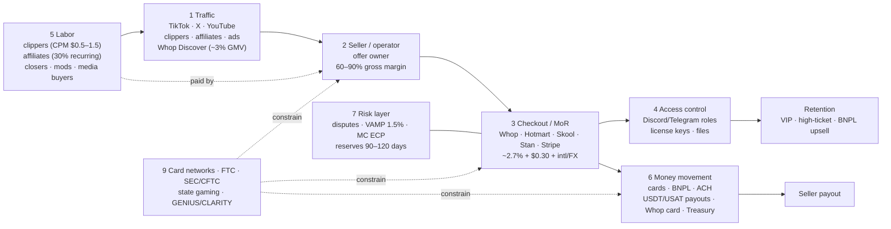

# The Whop-adjacent access economy

**As of:** September 2026 (research compiled 12 Oct 2026)
**Scope:** paid access to digital edge — gated Discord/Telegram, sports picks, trading/crypto signals, make-money-online (MMO) info products, clipping/content-rewards labor, bots/tools — and the checkout/payout layer that monetizes them.

**Labels used throughout**

| Tag | Meaning |
|---|---|
| **[V]** | Verified: regulator, audited/SEC filing, trade body, or company statement reported by credible press with a date |
| **[C]** | Company- or founder-claimed, unaudited |
| **[3P]** | Third-party estimate (Sacra, scrapers, aggregators) |
| **[E]** | My estimate — method and bottleneck assumption stated |

**Method limitation (read first).** Outbound page fetches were blocked in the research environment. Every figure here was taken from search-engine result summaries of the cited pages, not from reading the primary page. Treat fee schedules and regulatory specifics as "reported, pending primary read." Section 7 lists the verification pass that closes this.

---

## 1. Executive memo

**What the market is.** The access economy is not "the creator economy." It is a few billion dollars a year of card-funded payments for *the promise of an edge* — a pick, a signal, a system, a side income — sold mostly by young operators to young buyers, delivered inside Discord and Telegram, and acquired through short-form video, affiliates, and paid clipping. Bounded properly, the global market for Whop-shaped commerce is roughly **$7–14B GMV annualized in 2026 [E]**, of which **Whop processes roughly $3–4B on a run-rate basis [C]** and closer to **$1.3–1.7B in calendar 2025 [E, triangulated from Sacra]**. The demand it feeds on is much larger and is verified: US sports betting handled **$166.9B with $17.0B GGR in 2025 [V, AGA]**; Robinhood alone has **28.6M funded customers [V, Aug 2026]**; Kalshi plus Polymarket cleared **$44.8B notional in June 2026 [3P]**. The access economy is a thin, high-margin layer skimming hope off those pools.

**What Whop actually is in the value chain.** Despite the marketplace branding, Whop is primarily a **merchant-of-record checkout plus access-control plus payout rail for sellers who bring their own traffic.** In April 2025, Discover (the marketplace) was ~3% of GMV but ~20% of revenue [3P, Sacra]; Whop then cut the 30% Discover fee to 0% (May 2025) [3P]. Its moats are (a) willingness to underwrite categories Stripe-direct merchants struggle with, (b) Discord/Telegram role gating out of the box, (c) the affiliate and Content Rewards (clipping) networks that supply sellers with traffic, and (d) global payouts — now including USDT/USAT rails following Tether's **$200M investment at a $1.6B valuation (25 Feb 2026) [C, multi-outlet]**. Since then it has added a business card (May 2026), **Whop Treasury** (Mar 2026; up to 6% promotional APY on balances held as USDT0 and deployed via Aave on Plasma) [C, Whop docs/blog], and a white-label "neobank" product (~Sept 2026, third-party report). The strategic direction is clear: own seller balances, not just seller checkouts.

**The 4–5 use cases that pay the bills** (shares are [E]; no category data is disclosed):

1. **Trading / crypto / prop-firm education-that-is-really-alerts** — likely the largest GMV block; recurring $50–$300/mo plus affiliate kickbacks from prop firms and exchanges.
2. **MMO / "remote income" info products and high-ticket coaching** — remote sales, clipping, e-com, AI agency; the largest single disclosed seller (Shelby Haas, ~$1M/mo, remote sales) sits here [C, Fortune].
3. **Sports picks** — high count of small sellers, organic acquisition, very high churn; layered with sportsbook rev-share.
4. **Reselling / flipping / bots** — Whop's origin market; mature, smaller share.
5. **Content Rewards (clipping)** — small in GMV (~$40k/day payouts, ≈$15M/yr run-rate [3P citing Forbes, Apr 2026]) but large in *user count* and critical as the traffic engine for categories 1–3.

**The economic engine.** Sellers pay ~2.7% + $0.30 domestic, plus 1.5% for international cards and 1% for FX [3P]. Blended take rate was ~4.0% in 2022 and ~5.5% in early 2025 [3P, Sacra], with revenue reaching **~$142M annualized by Oct 2025, up from $56M at end-2024 [3P]**. After network and interchange costs, the platform probably retains ~1.5–3% of GMV before fraud and support losses [E]. The second P&L — BNPL financing fees, Content Rewards fees (7–10%), payout and FX fees, ads, and float on balances held 90–120 days for risky sellers — is where margin expands. On the seller side, gross margins are 60–90%. The real cost is acquisition: affiliate commissions (30% recurring is the default) [3P], paid clipping, and ads.

**Bull case.** Whop becomes the default financial stack for the 18–34 internet-native operator class worldwide. It is a checkout, bank, card, and stablecoin wallet for people Stripe-direct and US banks underserve. Demand pools keep growing (legal betting, retail trading, prediction markets). AI collapses the cost to launch an offer. Stablecoin rails convert ~$3–4B of payout flow into a balance and float business. The SMB expansion turns a "hustle" platform into a general merchant of record.

**Bear case.** This is a lottery with a rake. The median buyer churns within a few months having lost money on the underlying bets or trades. The median seller earns little, and roughly half of GMV sits with a few hundred sellers [3P claim]. Three exogenous forces can each compress volume quickly:
- **Card networks.** Visa's VAMP excessive threshold fell to **1.5% on 1 Apr 2026** [V-reported], and an aggregator inherits its worst sellers' dispute ratios.
- **The FTC.** It is running a sustained sweep against MMO/e-com coaching sellers (Click Profit >$20M in judgments, Ascend Ecom, Automators AI, Air AI).
- **Stablecoin yield rules.** The GENIUS Act regulations and the CLARITY Act draft target exactly the kind of pass-through yield Treasury advertises.

Prediction markets, still in litigation, are a direct substitute for paid picks.

**My read.** Today it is closer to **a lottery with a rake that is building a bank**. Roughly 60–80% of GMV is "hope product" [E]. The question for Whop's valuation is whether the fintech layer can be redeployed onto durable SMB and creator flows before network or regulatory de-risking hits the hope-product base.

---

## 0. Market definition and boundaries

| Layer | Definition | Unit of measure |
|---|---|---|
| **Core Whop category** | Paid membership, alerts, files, or software access sold via checkout; delivered in Discord/Telegram/app/download | GMV (gross buyer spend) |
| **Adjacent demand markets** | Legal sports betting; retail trading/crypto/prop-firm challenges; info products and coaching; clipping/affiliate labor; digital tools | Handle / GGR / revenue — *not additive with GMV* |
| **Infrastructure layer** | MoR checkout, role gating, BNPL, affiliates, ads, payouts (incl. stablecoin), balances/cards | Platform net revenue, take rate, float |

**In scope:** paid Discords/Telegrams; picks/cappers; signals and "education"; MMO courses and high-ticket coaching; reselling/bot groups; prompt/template/indicator sales; Content Rewards; Whop-like checkout platforms (Whop, Skool, Commas/Fanbasis, Stan, LaunchPass, Upgrade.chat, Discord Server Subscriptions, Telegram Stars) and the MMO-heavy share of Hotmart/Kajabi/Teachable.

**Out of scope:** Patreon fan subscriptions for artists and podcasters; evergreen professional courses (Coursera, Udemy, consultant Kajabi sites); adult (OnlyFans); physical goods (Shopify); brand deals and ad revenue (the bulk of the "$250–480B creator economy," Goldman [V] — **not this market**). Whoop (fitness wearable) is unrelated.

---

## 2. Sizing stack

### 2a. TAM — demand pools the supply sells into

| Pool | Metric | Figure | Date / geo | Tag | Conf. |
|---|---|---|---|---|---|
| US sports betting | Handle / GGR | $147.9B / $13.7B | 2024, US commercial | V (AGA) | M |
| US sports betting | Handle / GGR | **$166.9B / $17.0B** (handle +11%, GGR +22.8%) | 2025, US | V (AGA) | H |
| US sports betting | Handle / GGR | ~$79B / ~$7.7B (Q1+Q2 summed) | H1 2026, US | 3P aggregator | L–M |
| US sports betting | Hold | ~10.2% (2025); 10.1% (Q2 2026) | US | derived | M |
| US sports betting | 2030 gross win | $23.2B | US forecast | 3P (H2GC) | M |
| Legal states | Count | 39 + DC (any form); ~32 online | 2026 | 3P | M |
| Global gambling | GGR, all verticals | $712B (2024) → $1,031B (2030F) | Global | 3P (H2GC) | M–H |
| Global betting incl. racing | GGR | ~$305B | 2026F | 3P (H2GC) | M |
| Prediction markets | Monthly notional volume | $44.8B (Kalshi $31.5B, ~85% sports) | Jun 2026 | 3P | M |
| Retail brokerage | Robinhood funded customers | 28.6M | Aug 2026 | V | H |
| Crypto retail | Coinbase monthly transacting users | 8.7M | Q2 2025 | V (10-Q) | M |
| Prop-firm challenges | FTMO revenue | ~$423M (CZK 8.8B); net income −59% | 2025 | V-reported | M |
| Prop-firm industry | Revenue | ~$0.8–3B | 2026 | E (3P figures inconsistent) | L |
| Direct-to-fan digital | Patreon payouts | >$2B/yr; >$10B lifetime | Aug 2025 | C | H |
| Info products | Kajabi creator earnings | >$10B lifetime | Apr 2025 | C | H |
| Info products | Hotmart + Teachable creators | >$10B lifetime GMV | Mar 2024 | C | H |
| Distribution surfaces | Discord MAU / Telegram MAU | ~200M (company, 2025) / 1B+ | 2025–26 | C | M |

**Rejected as junk:** generic "e-learning $12.5B–$325B" ranges (definitions differ by 25×); "forex education $X billion" content-farm figures; Fairplay's $60B US GGR 2030 forecast (2024 base is half of AGA's actual figure); Track360's prop-firm totals (internally inconsistent).

### 2b. SAM — the Whop-shaped slice (all [E] unless tagged)

| Segment | 2026 GMV, annualized | Method / bottleneck assumption | Conf. |
|---|---|---|---|
| **Sports picks subscriptions** (all channels) | **$0.2–0.8B** | 1–3M paying US subscribers × $20–40/mo × 6–7 months average life. Cross-check: 0.1–0.5% of $167B handle. Only hard anchor: DubClub >$50M cumulative paid to cappers [C]. *Bottleneck: subscriber count.* | L |
| **Trading/crypto signals and education** (excl. prop-firm fees) | **$0.8–2.5B** | Low single-digit % of ~30–40M active US/EU retail traders paying $50–150/mo for 4–8 months, plus emerging-market buyers. *Bottleneck: paying penetration.* | L |
| **MMO info products and high-ticket coaching** (hustle-skewed) | **$3–6B** | Whop's largest category, plus most of Commas/Fanbasis, a large share of Skool's "Money" category, and the MMO share of Hotmart (Brazil "infoprodutos") and Kajabi. *Bottleneck: Hotmart/Kajabi category split.* | L–M |
| **Paid Discord/Telegram communities** (non-picks, non-signals: reselling, fitness, dating, lifestyle) | **$0.7–1.5B** | Skool ~15.9k paid communities [3P scrape]; Whop reselling and lifestyle; Discord Server Subscriptions and Telegram Stars undisclosed | L |
| **Tools / bots / indicators / prompts** | **$0.3–1.0B** | Sneaker/ticket bots, TradingView indicator seats, AI wrappers | L |
| **Content-rewards / clipping campaign spend** | **$0.05–0.3B** | Whop ~$40k/day ≈ $15M/yr payouts [3P citing Forbes]; plus off-Whop clipping agencies and campaigns | L–M |
| **Total SAM** | **≈ $7–14B** | Overlaps removed approximately. Cross-check by platform below. | L–M |

**Platform cross-check (annualized GMV, 2026):**

| Platform | GMV | Tag |
|---|---|---|
| Whop | $3–4B (run-rate) | C |
| Hotmart (MMO share only) | $1.5–2.5B | E |
| Skool | $0.6–1.5B; scraper upper bound $1.75B | E / 3P |
| Commas/Fanbasis | ~$1B (L) | C |
| Kajabi/Stan/Teachable (hustle share) | $1–2B | E |
| DIY Stripe + bots, LaunchPass, Upgrade.chat, Discord, Telegram | $1–3B | E |
| **Sum** | **≈ $8–14B** | Consistent with the segment build |

### 2c. SOM — Whop specifically

**Source table and reconciliation of the conflicting public figures**

| Claim | Figure | Source | Date | Likely definition | Tag | Conf. |
|---|---|---|---|---|---|---|
| GMV 2023 | $273M | Sacra | 2025 | Calendar GMV | 3P | M |
| GMV 2024 | **$410M** (Fortune: "~$400M a year") | Sacra; Fortune | 2024–25 | Calendar GMV | 3P | M |
| Monthly GMV | ~$80M (Dec 2024); ~$100M (Mar–Apr 2025) | Sacra | 2025 | Monthly | 3P | M |
| Revenue | $56M annualized (end-2024) → **$142M annualized** (Oct 2025) | Sacra | Oct 2025 | Net revenue run-rate | 3P | M |
| Take rate | 4.0% (2022) → ~5.5% (early 2025) | Sacra | 2025 | Revenue / GMV | 3P | L–M |
| Lifetime GMV | **$2.67B**; 183,628 sellers; 14.2M users | Sacra ("Whop reported") | Feb 2026 | Cumulative | 3P of C | M |
| Payouts | ">$3B annual payouts," 144 countries; 18.4M users; volume +25% MoM | Tether/Whop release | 25 Feb 2026 | Run-rate payouts | C | M |
| Commerce | "~$4B annual commerce"; ~22M users; ">650 millionaires" | Fortune | 14 Jun 2026 | Run-rate | C | M |
| Creator earnings | $845M cumulative; $8,413/mo average | Sacra | ~Oct 2025, undated | Unclear | 3P | **L** |
| Discover share | ~3% of GMV, ~20% of revenue | Sacra | Apr 2025 | Pre fee-cut | 3P | M |
| Concentration | Top 1% of products (~215 sellers) earn >50% of revenue | Third-party review | 2026 | Unclear | 3P | L |
| Content Rewards | ~$40k/day to clippers; ~1M videos/mo | Forbes via secondary | 29 Apr 2026 | Payout run-rate | 3P | L–M |
| Affiliates | 30,000 active | Sacra | Dec 2025 | Active affiliates | 3P | L–M |
| Valuation | $800M (Series B, $50M, Bain Capital Ventures) → **$1.6B** (Tether $200M) | Aggregators; The Defiant/PYMNTS/The Block | Mid-2024; 25 Feb 2026 | Post-money | 3P / C | M / H |
| Total raised | ~$272M | Fortune | Jun 2026 | Cumulative | V-reported | M |

**Resolving the conflicts**

- **$410M GMV vs $2.67B lifetime GMV vs $3–4B "annual."** These are three different measures, not one disagreement. $410M is *calendar 2024*. $2.67B is *cumulative through Feb 2026*. $3B and $4B are *forward run-rates* (latest month × 12) stated as "payouts" and "commerce" — undefined terms that may include Content Rewards payouts and non-card flows.
  - The reconciliation works: pre-2025 cumulative ≈ $0.8–0.9B, so 2025 plus Jan–Feb 2026 ≈ $1.8B. That implies **calendar 2025 GMV ≈ $1.3–1.5B** and an early-2026 monthly rate of ~$200–250M, i.e. a **$2.5–3B run-rate in Feb 2026**.
  - Sacra's $142M revenue run-rate in Oct 2025 at 5.5% implies ~$2.6B GMV run-rate. The two only fit if the late-2025 take rate had risen to ~6.5–7% as fintech revenue (BNPL, payouts, Content Rewards) grew. **Watch item.**
- **~10k vs ~180k sellers.** 183,628 counts *seller accounts ever created*. The "top 1% = ~215 sellers" claim implies ~21.5k *revenue-earning products/sellers* in the measured period. Both are probably right; they measure different things. Active earning sellers ≈ **15–25k [E]**.
- **4M visitors vs 14–22M users.** Registered accounts rose from 14.2M (Feb 2026, Sacra) to 18.4M (Feb 2026, Whop) to ~22M (Jun 2026, Fortune). The two February figures probably differ by date and definition. Registered users include clippers, free-tier members, and one-time buyers. Monthly marketplace visitors (~4M; source not located) measure a different thing, and Discover drives only ~3% of GMV. **Paying buyers ≈ 4–10M/yr [E]** ($3B ÷ $300–700 annual spend per buyer).
- **$845M "creator earnings."** This does not fit $2.67B lifetime GMV at a ~5% take rate. It is most likely an older snapshot. Discard.

**"What would have to be true" sanity check (Whop at $3.5B GMV run-rate)**

| If… | Then… | Plausible? |
|---|---|---|
| ~20k active earning sellers | Mean $175k/yr ($14.6k/mo) per seller | Yes — Sacra's $8.4k/mo mean was an earlier, lower-GMV point |
| Top ~215 sellers take >50% | Average ~$8M/yr ($680k/mo) each in that cohort | Yes — Shelby Haas ~$1M/mo is in this band |
| Remaining ~20k share <50% | Average ~$85k/yr; **median likely <$1k/mo** (Gumroad analog below) | Yes |
| Average buyer spends $40–60/mo for 5–7 months | ~6–17M paying buyers/yr | Upper end is too high vs ~22M registered → **average buyer spend is more likely $500+/yr**, driven by high-ticket sales and VIP tiers |
| 650 "millionaires" | 0.35% of 183k seller accounts; 0.003% of 22M users | Plausible on *lifetime gross sales*; meaningless as net worth |

**Power-law benchmark (Gumroad, disclosed by its CEO, July 2025) [C, H]:** 37,006 sellers earned money that month. 1,536 (4.2%) cleared $1k; 110 (0.3%) cleared $10k. Whop skews larger per seller, but the shape is the same. **Expect roughly 90–95% of earning Whop sellers below $1k/mo, and fewer than 1–2% above $10k/mo [E].**

---

## 3. Use-case map

Share of Whop-like GMV is [E]. Churn figures are [E] unless noted; the only sourced benchmark is ~5.3%/mo for paid communities generally, from a vendor blog (L).

| Use case | What the buyer thinks they buy | Price architecture | Delivery | Retention | Results verifiable? | Fraud / chargeback | GMV share | Class |
|---|---|---|---|---|---|---|---|---|
| **A1 Sports picks / locks / parlays** | Money from bets they would place anyway | $20–30/mo low; $40–100 mid; $200–500+ VIP; sportsbook rev-share on the side (one listing offers 30% net revenue share) | Discord, Whop app, X/Telegram | Very high churn: 15–30%/mo; spikes around NFL and the World Cup | Partly (trackable records, routinely cherry-picked) | High: "didn't win" disputes | **Medium** | Lottery |
| **A2 Crypto/forex/options/futures signals** | Trade calls that beat the market; a funded prop account | $50–300/mo; lifetime $500–2k; prop-firm and exchange affiliate kickbacks | Discord live calls, TradingView alerts | High churn: 10–20%/mo; drawdowns trigger mass exits | Rarely; P&L screenshots | High; Whop has suspended prop-account sellers | **High** | Lottery |
| **A3 "Education" that is alerts** | A skill (sold as a course, consumed as calls) | $97–297/mo + $2–10k mentorship | Discord + course portal | Medium-high | No | High | Within A2 | Lottery-leaning |
| **B1 Accountability / community Discords** | Belonging, discipline | $20–80/mo | Discord, Skool | Medium: 5–10%/mo | Self-reported | Medium | Low–Med | Mixed |
| **B2 Reselling / sneakers / card-break / flipping** | Restock info, early links, bots | $30–150/mo | Discord monitors | Medium; cyclical with hype drops | Yes (cook results are concrete) | Medium | **Low–Med** (declining since 2022) | Real but cyclical |
| **B3 Dating / fitness / masculinity / money-lifestyle** | Status, transformation | $30–100/mo + coaching | Discord, app | High | No | Medium-high | Low–Med | Lottery-leaning |
| **C1 Low-ticket courses and "systems"** | A side income | $20–200 one-off or monthly | Whop/Skool course, Discord | One-off; upsell funnel | No | Medium-high | **High** (with C2) | Lottery |
| **C2 High-ticket coaching / masterminds** | Done-with-you income ($1k–20k+) | Setter/closer sales; BNPL to lift conversion | Calls, Discord, Skool | 3–12-month programs | No; testimonials | **Very high**: refund fights, BNPL disputes, FTC target class | **High** | Lottery |
| **C3 Cloned funnels** | Same as C1/C2 | Same offer, new brand, often AI-built | Same | Short-lived brands | No | High | Embedded in C | Lottery |
| **D1 Indicators / bots / scrapers / seats** | Software edge | $20–200/mo license | License keys, TradingView invite | Low–medium churn if the tool works | Yes (it runs or it doesn't) | Low–Med | Low–Med | **Recurring** |
| **D2 Prompt packs / AI wrappers / templates** | Shortcut | $10–100 one-off | Files | One-off | Partly | Low | Low | Low-value, durable |
| **E1 Clipping / Content Rewards** | (Clipper) pay per view; (brand) distribution | CPM $0.50–1.50 typical, $0.20–6 range; 7–10% platform fee | TikTok/YT/IG + Whop tracking | Clipper churn very high | Views measurable but botted | **Bot fraud** on the brand side | Low GMV, **high users** | Labor market |
| **E2 Affiliates / Whop partners** | Commission | 30% recurring default, 60-day cookie, $50 threshold | Links | n/a | Yes | Affiliate fraud | Embedded cost | Labor market |
| **E3 Sellers' service providers** (closers, setters, media buyers, mods) | Wage or commission | 10–20% on high-ticket sales; flat fee for mods | Off-platform | n/a | n/a | n/a | Off-GMV | Labor market |
| **F1 Whop as MoR / payments API** | Checkout that will take my category | 2.7% + $0.30 + international/FX fees | API | Sticky once payouts live | n/a | Inherits seller risk | Growing | Infrastructure |
| **F2 Ads** | Traffic | Not disclosed | Whop surfaces | n/a | n/a | n/a | Small | Infrastructure |
| **F3 BNPL** (Afterpay, Klarna, Zip, Sezzle, others) | Ability to afford high-ticket | Financing fee reportedly ~15% (one source, unverified) | Checkout | n/a | n/a | Raises dispute exposure | Concentrated in C2 | Infrastructure |
| **F4 Card / Treasury / neobank / stablecoin** | Spend and earn yield on balances | Up to 6% promotional APY (USDT0 via Aave on Plasma); card May 2026 | Whop app | Balance stickiness | n/a | Regulatory, not chargeback | Float, not GMV | Infrastructure |
| **F5 Non-hustle SMBs** (barbers, detailers, gyms, agencies) | Simple checkout | Same as F1 | Same | — | — | — | **No evidence of traction found**; treat as narrative until Whop discloses a cohort | Narrative |

**Structurally high-churn lottery products:** A1, A2/A3, B3, C1–C3 — together an estimated **60–80% of Whop GMV [E]**.
**Real recurring businesses:** D1, B2 in-cycle, parts of B1, and F1–F4 as infrastructure.

---

## 4. Value chain

**Who captures what, who eats losses, where lock-in lives**

| Hop | Actor | Captures | Pricing power | Eats losses in a bad week | Lock-in |
|---|---|---|---|---|---|
| 1 Traffic | TikTok/X/YT; clippers; affiliates | Ad spend; CPM; 20–50% commissions | **Platforms high**; clippers none; top affiliates high | Clippers (budget runs dry, bot holds) | Audience on the social platform, not the seller |
| 2 Seller | Offer owner | Residual after all costs: 25–75% of revenue | Moderate; collapses if a clone undercuts | **Seller**, via refunds, chargebacks, reserves | Discord member list; brand of the face |
| 3 Checkout | Whop et al. | 3–7% blended | Low on processing; high on "will accept my category" | Platform, when seller balance is negative after disputes | Payout history, reserves held, affiliate graph |
| 4 Access | Discord, Telegram | Nothing (Discord native takes 10%) | Latent: a policy change kills distribution | — | Server, roles |
| 5 Labor | Clippers, closers, mods | CPM; 10–20% on high-ticket | Low (closers higher) | Clippers and setters | None |
| 6 Money | Networks, BNPL lenders, Tether, Whop Treasury | Interchange; ~15% financing fee (unverified); float | Networks high; BNPL medium | BNPL lender (credit loss) | **Balances, card, USDT wallet — the new lock-in** |
| 7 Risk | Whop T&S, acquirers | Reserves (float) | High (unilateral holds) | Platform's acquirer relationship | Funds held 90–120+ days |
| 8 Rake | Platform | Processing + fees + ads + FX | Medium | — | — |
| 9 Constraint | Visa/MC, FTC, SEC/CFTC, states | Fines, bans | Absolute | Everyone | — |

**Narrative.** Attention is rented from social platforms and bought from clippers and affiliates. Trust is manufactured by a face, P&L screenshots, and testimonials. Whop's real product is the third hop: it says yes to sellers other checkouts decline, then manages the consequences through reserves and dispute-score suspensions. The structural shift in 2026 is hop 6. By paying out in USDT/USAT and offering yield and a card on balances, Whop moves lock-in from "my Discord is wired to Whop" to "my money lives on Whop." That is the same play Stripe and Shopify ran with Capital and Balance, applied to a riskier seller base.

---

## 5. Unit economics

### 5a. Platform (Whop-like), per $100 of GMV [E unless tagged]

| Line | Range | Note |
|---|---|---|
| Gross take (processing + platform + international/FX) | $4.5–7.0 | 5.5% blended early 2025 [3P]; rising with fintech revenue |
| Network, interchange, processor cost | −$2.2–3.0 | Higher on international cards |
| Fraud and chargeback losses not recovered from sellers | −$0.2–0.8 | Whop says it cannot support a seller dispute rate >2% [C] |
| Support, trust and safety, KYC | −$0.3–0.6 | Compliance reviews at first sale, $1k, $5k [C] |
| **Contribution from core processing** | **~$1.0–2.5** | |
| Second P&L: BNPL fee share, Content Rewards (7–10% of campaign spend), payout and instant-withdrawal fees, ads, partner overrides | +$0.5–2.0 | Ads and BNPL economics undisclosed |
| Float on balances and reserves | +$0.1–0.4 | ~10–20 days of GMV held on average × 4–5% yield ≈ $100–200M balance at $3.5B GMV → $4–10M/yr. **Thin, and negative where the 6% promotional APY is passed through.** Treasury is a retention and Tether-distribution play, not a profit line |

**Why Tether and stablecoins matter to the model:**
1. Payouts to sellers in 144 countries, many unbankable or under-served by Stripe Connect.
2. Settlement independent of correspondent banks that de-risk "get rich quick" categories.
3. Balances that stay on-platform.
4. Distribution for Tether's USDT/USAT inside a 20M-user app.

USDT cannot escape card chargebacks — buyers still pay by card. It only removes the payout-side bank dependency.

**Valuation check.** $1.6B ÷ ~$142M revenue run-rate (Oct 2025) ≈ 11× trailing run-rate. At an assumed ~$200M+ run-rate in Feb 2026, that is ~7–8×. Reasonable for a payments business growing ~150–250% a year, if the volume is durable.

### 5b. Seller archetypes (monthly P&L, [E])

| | **1. Picks Discord** | **2. Cloned signals/MMO funnel** | **3. Whale** |
|---|---|---|---|
| Revenue | **$10k** | **$100k** | **$600k** |
| Price architecture | $39/mo base; $99 VIP | $97/mo front end; $297 VIP; $3–5k coaching (~30% of revenue, BNPL) | $49–199/mo community; $5–15k high-ticket (~50%); clipping-driven top of funnel |
| Paying members | ~220 | ~700 subscribers + ~8 high-ticket closes | ~4,000 subscribers + ~30 high-ticket closes |
| Monthly churn | 20–30% | 12–20% | 8–15% |
| New members needed per month to stay flat | ~55 | ~110 + new closes | ~450 + closes |
| Acquisition | Organic X/TikTok; record screenshots; a little clipping | ~50% via affiliates (30% recurring); paid ads; clipping | Content Rewards campaigns ($20–60k/mo); affiliates; ads; setter/closer team |
| Platform fees (~4–6%) | −$500 | −$5,000 | −$30,000 |
| Affiliate commissions | — | −$15,000 | −$60,000 |
| Ads / clipping | −$300 | −$12,000 | −$90,000 |
| Closers / setters (10–20% of high-ticket) | — | −$4,500 | −$45,000 |
| Mods, support, editors | −$800 | −$6,000 | −$40,000 |
| Refunds and chargebacks (2–8%) | −$300 | −$5,000 | −$30,000 |
| Reserve drag | Small | ~5–10% of revenue held 90 days | Negotiated |
| Side income: sportsbook / prop-firm / exchange rev-share | +$1–4k | +$5–20k | +$20–100k |
| **Operator net (pre-tax, incl. side income)** | **~$9–12k (90–120% of checkout revenue)** | **~$57–72k (57–72%)** | **~$325–405k (54–68%)** |
| LTV : CAC | LTV ≈ $39 / 0.25 ≈ $150; CAC ≈ $5–20 (organic) → **8–30×** | LTV ≈ $500–700 blended; CAC ≈ $150–250 → **~2.5–4×** | LTV ≈ $1–2k; CAC ≈ $300–600 → **~3×** |
| Dies if paid acquisition stops? | No — but dies on a cold streak | **Yes, within 3–6 months** (churn outruns organic) | Shrinks to the founder's organic audience |

**Common stack:** $29–99/mo front end, then "VIP" signals, then high-ticket coaching, plus off-platform affiliate rev-share from sportsbooks, prop firms, and exchanges, with BNPL to close the high-ticket step. **Affiliate rev-share from the venue where the buyer loses money is often a material share of seller income.** That incentive misalignment is the core of the bear case and the most likely enforcement theory.

### 5c. Buyer

- **Perceived value:** a subscription that pays for itself after one winning week, so perceived LTV is effectively unbounded. **Realized value:** negative for most. Recreational bettors lose ~10% of handle at today's hold, and parlay-heavy mixes are worse. Most retail day-traders lose money (well documented across broker disclosures; not re-verified here).
- **Time to churn:** 2–4 months on picks and signals; one-shot purchases for courses [E].
- **Overlap:** high. Bettors, crypto traders, and MMO buyers share demographics (18–34, male-skewed) and acquisition channels. Clippers become buyers of clipping courses.
- **Chargeback behavior:** high willingness. Trustpilot themes include ignored refund emails escalated to bank chargebacks, and "unrecognized" Whop charges (the buyer saw "Whop," not the creator's name).

### 5d. Affiliate / clipper / partner

| Role | Economics | Source |
|---|---|---|
| Whop affiliate (default) | 30% recurring, 60-day cookie, $50 threshold; custom and rev-share tracks | 3P / Whop docs |
| Seller-set affiliates on MMO offers | 30–50% of front end common | E |
| Sportsbook affiliate | 25–40% net-revenue share or CPA; one Whop picks listing offers 30% | 3P / one listing |
| Clipper | CPM $0.50–1.50 typical. 100k views ≈ $50–150. Payout ~10 days after approval. Bot-view reviews hold payouts. Budgets deplete before late submitters get paid | 3P blogs |
| Clipping platform take | 7–10% of campaign spend | 3P |
| Whop partners (migrating businesses) | Exists; rate not disclosed | 3P |

### 5e. Power law

"650 millionaires among ~22M users" is 0.003% of users and ~0.35% of seller accounts. Using the Gumroad distribution, ~90–95% of active sellers clear less than $1k/mo. Combined with the "top ~215 sellers take >50%" claim, **this is a winner-take-most economy — and that is what a lottery with a rake looks like on the supply side.** The marketing number (millionaires) and the distribution (median seller <$1k/mo) are both true at once.

---

## 6. Tailwinds and headwinds

| Force | Direction | Impact | Horizon | Evidence |
|---|---|---|---|---|
| US legal betting scale; 2026 World Cup and NFL calendar | Tailwind | H | 0–12 mo | $166.9B handle 2025 [V]; ~$60B global World Cup handle projected [3P, H2] |
| Rising hold / parlay mix | Mixed: more GGR, faster bettor losses → picks churn and blame | M | 1–3 yr | GGR +22.8% on handle +11% (2025) [V] |
| Youth underemployment; collapse of the default career path | Tailwind | M–H | 1–3 yr | Not sourced in this pass |
| Discord/Telegram as the 18–34 default venue | Tailwind | M | ongoing | ~200M / 1B+ MAU [C] |
| AI lowers the cost to clone funnels and storefronts | Tailwind for volume, **headwind for trust** | H | 0–12 mo | FTC "Operation AI Comply" cases [V-reported] |
| Bundled checkout + gating + BNPL + affiliates + clipping | Tailwind (startup friction falls) | H | now | Whop product set |
| Emerging-market sellers without Stripe; stablecoin payouts | Tailwind | M–H | 0–3 yr | 144 countries; Tether WDK, USDT/USAT [C] |
| Real SMBs onto the same rails | Tailwind, if real | L (unproven) | 1–3 yr | No traction evidence found |
| **Visa VAMP to 1.5% (Apr 2026); Mastercard ECP; Mastercard ECM step-down reported from 2027** | Headwind | **H** | **0–12 mo** | Vendor summaries of network bulletins |
| **FTC sweep on earnings claims / MMO coaching** (Click Profit >$20M; Ascend Ecom ≥$25M in alleged losses; Automators AI $21.7M; Air AI) | Headwind | **H** | 0–12 mo | FTC filings; law-firm summaries |
| FTC Business Opportunity Rule expansion to coaching | Headwind (latent) | M | 1–3 yr | NPRM Jan 2025; no 2026 final rule found |
| SEC "personalized advice" line (Lowe v. SEC); Atlas Trading Discord pump-and-dump (2022) | Headwind for signals | M–H | 1–3 yr | Case law; SEC/DOJ charges |
| ROSCA / negative-option enforcement on subscriptions | Headwind | M | 0–12 mo | FTC v. JustAnswer (Jan 2026); June 2026 suit |
| **GENIUS Act rules (effective by 18 Jan 2027) and CLARITY Act §404 yield limits vs Whop Treasury's 6% promo APY** | Headwind | **H** | 0–12 mo | OCC NPRM 25 Feb 2026; Senate compromise 1 May 2026 |
| Money-transmitter status unverified for balances, cards, payouts | Headwind | H | 1–3 yr | No MTL or sponsor bank found in public sources |
| Prediction markets substituting picks (Kalshi ~85% sports; Ninth Circuit 28 Aug 2026 against Kalshi; NJ cert petition ~2 Sep 2026) | Headwind for picks; possible new "signals on Kalshi" product | M | 1–3 yr | Court reporting |
| Discord Ads Policy bans picks/handicapping and crypto promotion in ads | Headwind on paid acquisition | M | now | Discord policy |
| Clipping bot-view fraud → brand budgets pull back | Headwind on traffic engine | M | 0–12 mo | Clipper complaints; anti-bot holds |
| Trust collapse: clones, inflated reviews, refund hostility (Trustpilot ~3.5–3.7 on ~2.2–2.7k reviews) | Headwind | M | 1–3 yr | Trustpilot; BBB complaint profile |
| Seller-side platform risk: freezes at withdrawal, holds of 120–200+ days | Headwind (seller migration to Stripe-direct or Skool) | M | ongoing | Trustpilot; Costbench |
| Competition: Skool (community), Stripe + owned site (serious operators), Commas/Fanbasis (MMO) | Headwind on take rate | M | 1–3 yr | Fee compression already visible: Discover 30% → 0% |
| **Concentration**: if picks + signals + MMO ≥ 60% of GMV, one crackdown or cultural fade hits the whole platform | Headwind | **H** | 1–3 yr | E |

---

## 6b. Customer reality check

- **Median buyer vs median dollar.** The median buyer is an 18–30-year-old paying $30–100/mo for picks, signals, or a course and churning within ~3 months. The median *dollar* is more likely a high-ticket coaching or VIP purchase ($1k+), often BNPL-financed, sold by a closer for a top-200 seller.
- **Share of "hope products":** **60–80% of GMV [E]** (A1, A2/A3, B3, C1–C3). Durable software and SMB: **≤10–15% [E]**.
- **Creator middle class or lottery with a rake?** The distribution says lottery with a rake on both sides. Buyers mostly lose on the underlying activity, and sellers mostly earn little. A real middle class of perhaps 1–3k sellers clearing $10k+/mo exists on top.
- **Stress scenarios:**

| Scenario | Effect on GMV [E] |
|---|---|
| Refund policy tightens (buyer-protective) | Disputes fall, but conversion on high-ticket falls; GMV −10–20% |
| Discover cleaned up | ~Neutral; Discover is ~3% of GMV |
| Card networks force de-risking (MCC reclassification, higher reserves, acquirer exits) | GMV −30–60% in affected categories; volume shifts to crypto checkout, Telegram Stars, offshore processors. This is the existential scenario |
| FTC targets the platform as an "assisting" party | Product changes (earnings-claim review, cancellation flows); seller exits at the top |

**Primary color collected** (search summaries; quotes ≤25 words):
- Trustpilot ~3.5–3.7.
- Seller theme: "suspended for fraudulent activity" with no disputes.
- Holds "kept extending" after the customer issue was resolved.
- Funds held >207 days (one account).
- Buyer theme: refund emails ignored, leading to bank chargebacks.
- BBB: Whop's reply that creators, not Whop, made the charges — the MoR-vs-seller liability tension in one line.
- TJR: Whop blog claims "32% revenue growth in one month," with no dollar figure.

All of the above is anecdote until a structured scrape (Section 7).

---

## 7. Open questions and how to verify

| Question | How to verify |
|---|---|
| Category mix of Whop GMV | Scrape Whop Discover: listing category, price, member/review counts, "joined" counts; weekly snapshots for churn proxies. Cross-reference with Similarweb referral data |
| Active vs registered sellers and buyers | Whop disclosure; alternatively, sample storefront "members" counters over time |
| Concentration (top 1% / 10% share; sellers >$1k/$10k/$100k/$1M) | Ask Whop directly; Sacra full report; leaderboard scrapes |
| Current fee schedule incl. 3% platform fee (conflicting), BNPL fee, ads, instant payout | Read whop.com/pricing and docs.whop.com/fees first-hand (blocked in this pass) |
| Reserve % by risk tier; new-seller payout delay | docs.whop.com trust-and-safety pages; seller interviews |
| Whether picks/signals are prohibited or restricted | whop.com/prohibited-products-and-services |
| MTL licenses / sponsor bank / card issuer | NMLS Consumer Access search for Whop entities; card BIN lookup; Treasury and card terms |
| Treasury structure vs GENIUS/CLARITY | Treasury terms; OCC final rule; CLARITY Act final text |
| Tether deal structure (equity vs debt; payout exclusivity) | Delaware filings; Tether attestation notes |
| Content Rewards GMV and bot rejection rates | Forbes 29 Apr 2026 piece; Whop docs; clipper Discord surveys |
| Chargeback/dispute ratio at platform level | Not public; infer from acquirer changes and reserve tightening reports |
| Picks/signals subscriber counts | Action Network PRO, DubClub disclosures; capper interviews |
| Hotmart MMO share of GMV (Brazil) | Hotmart investor and press materials; Exame "R$50B cumulative" article body |
| Prediction-market status (cert petition, Fourth Circuit) | Supreme Court docket; Action Network lawsuit tracker |

**Metrics Whop would need to disclose to settle the debate:** calendar GMV by category; GMV from new vs returning buyers; seller cohort retention; dispute rate by category; share of GMV from top 100 sellers; Treasury balances; payout mix (fiat vs USDT).

---

## 8. Red-team appendix

**Strongest case that the market is much smaller than claimed.**
- "$3B annual payouts" and "$4B annual commerce" are run-rates from the best month of a 25%-MoM growth spurt, not realized volume. Calendar 2025 was probably ~$1.3–1.5B.
- Some "payouts" are Content Rewards and affiliate flows that net against seller GMV — double-counting.
- Registered users (22M) include clippers chasing $1 CPMs and free-tier members. Paying buyers are likely 4–8M.
- 50%+ of revenue sits with ~200 sellers. Remove ten whales and the growth curve flattens.
- The demand is cyclical and fad-driven: sneakers (2021–22), crypto (2021, 2024–25), betting and the World Cup (2026).
- One card-network intervention could cut the hope-product base by half. On that view the durable market is **$2–4B globally**, and Whop's durable GMV is **$1–1.5B**.

**Strongest case that it is much bigger.**
- Public figures undercount because most of this economy never touches a platform that discloses anything: Stripe-direct sites, Telegram Stars, crypto-paid signal groups, PayPal F&F, Pix-funded Brazilian infoprodutos, and Discord bots on custom Stripe accounts.
- Hotmart alone reports >$10B cumulative GMV. Stripe processed $1.9T in 2025, with high-risk info-product merchants a rounding error inside it that would still be billions.
- If the true off-platform market is 2–3× the visible one, global access-economy GMV is **$20–30B**.
- Whop's fintech layer (Treasury, card, USDT payouts) monetizes balances regardless of category, so its addressable revenue is a share of the operator class's *financial life*, not just its sales.

**What would change my mind.**
- **Toward "real business":** Whop discloses that more than 30% of GMV comes from software, SMB, or community sellers with less than 5%/mo churn, and platform dispute rates below 0.5%.
- **Toward "lottery with a rake":** a reported acquirer exit or reserve tightening; an FTC complaint naming a platform as an assisting party; Whop Treasury restructured after the GENIUS/CLARITY rules; Discover scrape showing more than 70% of top-grossing listings in picks, signals, or MMO.
